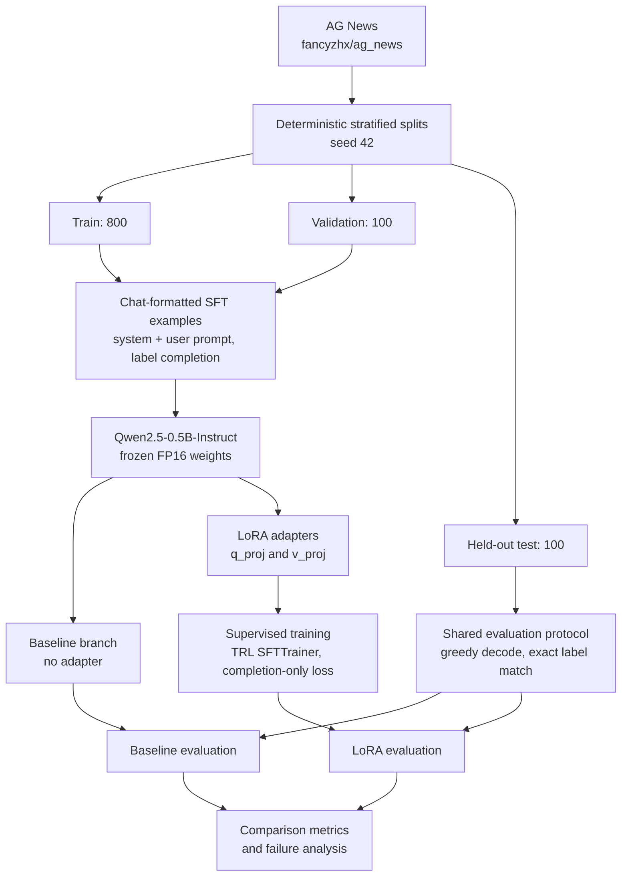

# Task 1: LoRA Fine-Tuning for Four-Class News Classification

This repository is the completed **TNDRR internship Task 1** experiment: parameter-efficient supervised fine-tuning of [`Qwen/Qwen2.5-0.5B-Instruct`](https://huggingface.co/Qwen/Qwen2.5-0.5B-Instruct) for AG News classification.

The base model is a causal language model, not a classification head. The task is framed as instruction following: given a news article in a chat template, the model must return exactly one of `WORLD`, `SPORTS`, `BUSINESS`, or `SCI_TECH`. LoRA adapters are trained on 800 labeled examples; the frozen pretrained weights are left unchanged.

This is a **finished research experiment with saved artifacts**, not a deployed classifier, API, or product.

Executed notebook: [`notebooks/LoRA_FineTuning.ipynb`](notebooks/LoRA_FineTuning.ipynb)

---

## 1. Objective

The assignment is to demonstrate LoRA (Low-Rank Adaptation) on a small instruction-tuned LLM:

1. Establish a **baseline** by evaluating the unmodified Qwen model on a held-out AG News subset.
2. Attach **LoRA adapters** to selected attention projections and train them with supervised fine-tuning (SFT).
3. Evaluate the adapted model on the **same** held-out examples.
4. Inspect real misclassifications and compare theoretical 7B fine-tuning memory with the measured 0.5B run.

The experiment answers a narrow question: *can rank-8 LoRA on `q_proj` and `v_proj` teach this 0.5B instruct model to emit AG News labels under a fixed prompt, using 800 training articles on a Tesla T4?*

It does not answer whether LoRA is universally better than full fine-tuning, whether the same recipe transfers to other datasets, or whether the adapter is production-ready.

---

## 2. Architecture

Two evaluation branches share the dataset construction, prompt template, truncation, and decoding procedure. They differ only in whether LoRA adapters are applied.



**Baseline branch.** The pretrained instruct model is loaded in FP16 and evaluated immediately. No adapter weights are trained or merged.

**Fine-tuned branch.** PEFT injects LoRA matrices into `q_proj` and `v_proj`. TRL's `SFTTrainer` updates only those matrices. After two epochs, the same `predict_label` routine scores the same 100 test articles. Predictions are aligned to the baseline CSV by article text before metrics are compared.

---

## 3. How LoRA is applied here

A pretrained linear layer computes \(h = Wx\). Full fine-tuning would update every entry of \(W\). LoRA keeps \(W\) **frozen** and learns a low-rank residual:

\[
W' = W + \frac{\alpha}{r}BA
\]

- \(W \in \mathbb{R}^{d_{\text{out}} \times d_{\text{in}}}\) — original weight, not trained.
- \(A \in \mathbb{R}^{r \times d_{\text{in}}}\) — down-projection, trained.
- \(B \in \mathbb{R}^{d_{\text{out}} \times r}\) — up-projection, trained.
- \(r\) — rank (here **8**).
- \(\alpha\) — scaling coefficient (here **16**), so \(\alpha / r = 2\).

PEFT applies dropout to the input of \(A\), then \(B\), then scales by \(\alpha/r\). Adapters are initialized so the residual starts near zero; early training does not immediately overwrite pretrained behaviour.

### Why this reduces trainable parameters and optimizer memory

For one matrix, full fine-tuning stores \(d_{\text{out}} \times d_{\text{in}}\) trainable values. LoRA stores \(r(d_{\text{in}} + d_{\text{out}})\). With \(r \ll \min(d_{\text{in}}, d_{\text{out}})\), the adapter is much smaller than \(W\).

The AdamW optimizer keeps first and second moments for **trainable** tensors only. Frozen \(W\) still occupies GPU memory as weights, but it does not add gradient or optimizer-state tensors. That is the main memory saving versus updating all 494,573,440 model parameters.

On this run, PEFT reported:

```text
trainable params: 540,672 || all params: 494,573,440 || trainable%: 0.1093
```

The saved `adapter_model.safetensors` contains 96 tensors whose shapes sum to **540,672** parameters, matching that report.

### Target modules and PEFT integration

Adapters are attached only to attention **query** and **value** projections (`q_proj`, `v_proj`) in every transformer block. Other modules, including `k_proj` and MLP layers, remain frozen.

`SFTTrainer` received `peft_config=lora_config`. TRL/PEFT wrapped the Hugging Face causal LM, marked base weights non-trainable, and registered the LoRA parameters with the optimizer. After training, `save_pretrained` wrote the adapter and tokenizer under [`adapters/lora_adapter/`](adapters/lora_adapter/), not a full copy of Qwen.

Configuration (notebook `LoraConfig` and [`adapters/lora_adapter/adapter_config.json`](adapters/lora_adapter/adapter_config.json)):

| Item | Value |
| --- | --- |
| Rank \(r\) | 8 |
| Alpha \(\alpha\) | 16 |
| Target modules | `q_proj`, `v_proj` |
| LoRA dropout | 0.05 |
| Bias | none |
| Task type | `CAUSAL_LM` |
| PEFT version | 0.21.3 |

Training hyperparameters (notebook `SFTConfig` and [`results/experiment_metadata.json`](results/experiment_metadata.json)):

| Item | Value |
| --- | --- |
| Epochs | 2 |
| Learning rate | \(2 \times 10^{-4}\) |
| LR schedule | linear, 5 warmup steps |
| Optimizer | `adamw_torch` |
| Per-device train batch | 4 |
| Gradient accumulation | 4 |
| **Effective batch size** | **16** |
| Eval batch size | 8 |
| Max sequence length | 256 |
| Packing | false |
| Loss | **completion-only** (`completion_only_loss=True`) |
| Precision | FP16 (`fp16=True`) |
| Seed | 42 |

Completion-only loss means tokens in the chat prompt are masked (`labels = -100`); the supervised target is the category string plus the end-of-turn token, for example `WORLD<|im_end|>`. Token-level training metrics therefore describe next-token prediction on that short completion, **not** held-out classification accuracy.

---

## 4. Experiment setup

| Item | Value | Source |
| --- | --- | --- |
| Base model | `Qwen/Qwen2.5-0.5B-Instruct` | metadata, adapter config |
| Dataset | `fancyzhx/ag_news` | metadata |
| Official AG News sizes | 120,000 train / 7,600 test | notebook load output |
| Experimental train / val / test | 800 / 100 / 100 | metadata |
| Hardware | NVIDIA Tesla T4 (14.56 GiB) | notebook |
| Model load dtype | `torch.float16`, `device_map="auto"` | notebook |
| Frameworks | Transformers, TRL, PEFT | notebook, requirements |

### Labels

AG News integer labels are mapped to instruction tokens:

| Dataset label | Instruction label |
| ---: | --- |
| 0 | `WORLD` |
| 1 | `SPORTS` |
| 2 | `BUSINESS` |
| 3 | `SCI_TECH` |

The model is required to emit one of those four strings and nothing else. Any other generation would be scored as `INVALID`. Both evaluations recorded **zero** invalid outputs.

### Deterministic stratified sampling

From the official **train** split, each class contributes 200 training and 25 validation indices (`random.Random(SEED + label)` with `SEED = 42`). Train and validation index sets are asserted disjoint. From the official **test** split, each class contributes 25 held-out articles (`SEED + 100 + label`). Splits are then shuffled with `seed=42`.

Resulting class counts are 200 / 25 / 25 per label. This is a **balanced subsample**, not the full AG News training set.

### Prompts, truncation, and decoding

System instruction (verbatim from the notebook):

> You are a news classification assistant. Classify each news article into exactly one category: WORLD, SPORTS, BUSINESS, or SCI_TECH. Return only the category label, without explanation.

User content is `News article:` followed by the article text. Articles are truncated to **160 tokenizer tokens** *before* the chat template is applied, so template tokens are not consumed by the article budget. Training concatenates `apply_chat_template(..., add_generation_prompt=True)` with the gold label and EOS. The longest training sequence measured in the notebook was **218** tokens, which fits `max_length=256`.

Inference uses greedy decoding (`do_sample=False`, `max_new_tokens=12`) and scores only newly generated tokens. Baseline and LoRA evaluation call the same `predict_label` helper. The LoRA evaluation cell asserts that baseline CSV articles match the live test split before scoring.

---

## 5. Measured results

Sources: [`results/baseline_metrics.json`](results/baseline_metrics.json), [`results/finetuned_metrics.json`](results/finetuned_metrics.json), [`results/experiment_metadata.json`](results/experiment_metadata.json), prediction CSVs, notebook training output, and [`results/training_logs.json`](results/training_logs.json).

### Headline comparison

| Metric | Baseline | LoRA |
| --- | ---: | ---: |
| Accuracy | 0.28 | 0.84 |
| Macro-F1 | 0.20582357978875251 | 0.8383480248783577 |
| Correct / 100 | 28 | 84 |
| Invalid outputs | 0 | 0 |

Accuracy improved by **56 percentage points** (28% → 84%). Macro-F1 improved from **0.2058** to **0.8383** (rounded to four decimals, as printed in the notebook).

### Resource measurements (this 0.5B run)

| Quantity | Value | Notes |
| --- | --- | --- |
| Trainable LoRA parameters | 540,672 | PEFT report and safetensors tensor sizes |
| Trainable parameter share | 0.1093% | 540,672 / 494,573,440 |
| Training runtime | 119.07 s (~1 min 59 s) | `train_runtime` in training logs |
| Mean training loss | 0.21561040997505188 | SFTTrainer `train_loss` |
| Peak PyTorch GPU allocation | 1.95 GiB | `torch.cuda.max_memory_allocated` in the notebook; **not** stored in the JSON metrics |

Peak GPU memory is a PyTorch allocator figure for this run. It is not the theoretical 7B estimate in Section 8.

### Per-class results

Sklearn `classification_report` values from the notebook (support = 25 per class).

**Baseline**

| Class | Precision | Recall | F1 |
| --- | ---: | ---: | ---: |
| WORLD | 0.24 | 0.84 | 0.37 |
| SPORTS | 0.83 | 0.20 | 0.32 |
| BUSINESS | 0.00 | 0.00 | 0.00 |
| SCI_TECH | 0.33 | 0.08 | 0.13 |

The unmodified model predicted `WORLD` on 88 of 100 test articles. BUSINESS recall was 0/25. High WORLD recall (21/25, 84%) therefore reflects a strong WORLD prior, not a calibrated four-way classifier.

**LoRA**

| Class | Precision | Recall | F1 |
| --- | ---: | ---: | ---: |
| WORLD | 0.77 | 0.68 | 0.72 |
| SPORTS | 0.96 | 1.00 | 0.98 |
| BUSINESS | 0.88 | 0.84 | 0.86 |
| SCI_TECH | 0.75 | 0.84 | 0.79 |

SPORTS, BUSINESS, and SCI_TECH improved sharply. **WORLD recall fell from 84% to 68%** (21/25 → 17/25) even though WORLD precision rose (0.24 → 0.77) and overall accuracy rose. LoRA reduced the WORLD default; some true WORLD articles were then assigned BUSINESS or SCI_TECH. Eight of the sixteen LoRA errors are true WORLD examples ([`results/all_failure_cases.csv`](results/all_failure_cases.csv)).

Confusion counts from the prediction CSVs (rows = gold, columns = predicted):

**Baseline**

|  | WORLD | SPORTS | BUSINESS | SCI_TECH |
| --- | ---: | ---: | ---: | ---: |
| WORLD | 21 | 1 | 0 | 3 |
| SPORTS | 19 | 5 | 0 | 1 |
| BUSINESS | 25 | 0 | 0 | 0 |
| SCI_TECH | 23 | 0 | 0 | 2 |

**LoRA**

|  | WORLD | SPORTS | BUSINESS | SCI_TECH |
| --- | ---: | ---: | ---: | ---: |
| WORLD | 17 | 1 | 3 | 4 |
| SPORTS | 0 | 25 | 0 | 0 |
| BUSINESS | 1 | 0 | 21 | 3 |
| SCI_TECH | 4 | 0 | 0 | 21 |

### Validation loss during training

`SFTConfig` evaluated at each epoch. Logged **eval_loss** is token-level completion loss on the 100 validation chat examples, not classification accuracy.

| Epoch | Step | Train loss (logged) | Eval loss | Eval mean token accuracy |
| ---: | ---: | ---: | ---: | ---: |
| 1.0 | 50 | 0.1907 | 0.2016 | 0.9288 |
| 2.0 | 100 | 0.1322 | 0.1726 | 0.9437 |

Eval loss decreased from **0.2016** to **0.1726**. Logged train loss fell from 0.537 at step 10 to 0.132 at step 100. Mean token accuracy is the fraction of supervised completion tokens predicted correctly during SFT. **It is not held-out news-category accuracy.** Classification metrics in this README come only from greedy generation on the 100 test articles.

---

## 6. Three documented failure cases

LoRA misclassified **16 / 100** test articles. Three cases were selected for write-up (one from WORLD, BUSINESS, and SCI_TECH) and stored in [`results/failure_cases.csv`](results/failure_cases.csv). The notes below separate **what the files show** from **a plausible reading of category overlap**. They are not claims about internal model reasoning.

### Case 1 — Malaysia bird flu (test index 12)

- **Article:** “Malaysia discovers new bird flu case … Malaysia discovered new cases of bird flu on Sunday within a quarantine area in northern Malaysia…”
- **Gold:** `WORLD`
- **Baseline:** `WORLD` (correct)
- **LoRA:** `SCI_TECH` (incorrect)

Observation: LoRA changed a correct WORLD prediction into SCI_TECH. A plausible explanation is overlap between an international outbreak story and disease/science vocabulary. That explanation is interpretive.

### Case 2 — Plasma television retailing (test index 25)

- **Article:** “Retailers Looking to Move Plasma TV's (AP) … Retailers hope that St. Nicholas soon will be there … to hang a 42-inch plasma-screen TV.”
- **Gold:** `BUSINESS`
- **Baseline:** `WORLD` (incorrect)
- **LoRA:** `SCI_TECH` (incorrect)

Observation: both models are wrong; LoRA moved the error from WORLD to SCI_TECH rather than to BUSINESS. The text mixes retail seasonality with a consumer-electronics product. Whether the adapter overweighted the device terms is a hypothesis, not a measured causal effect.

### Case 3 — Southern Africa food and water study (test index 29)

- **Article:** “Southern Africa Faces Food, Water Crises - Study (Reuters) … faces major challenges to feed its swelling populations and to keep its wells from running dry, a study showed Wednesday.”
- **Gold:** `SCI_TECH`
- **Baseline:** `WORLD` (incorrect)
- **LoRA:** `WORLD` (incorrect)

Observation: both models predicted WORLD. The gold label is SCI_TECH, presumably because the article is framed as reporting a study. The same geographic-crisis cues are also typical of WORLD news. The files do not establish which cues the model used.

The remaining thirteen errors are listed without narrative in [`results/all_failure_cases.csv`](results/all_failure_cases.csv). Several other WORLD gold labels were predicted BUSINESS or SCI_TECH (for example labour and public-health stories), which is consistent with residual category overlap on a 100-example test set.

---

## 7. Theoretical 7B GPU-memory estimates

[`results/memory_estimates.json`](results/memory_estimates.json) is a **parameter-arithmetic sketch for a hypothetical 7B model**. It is not a profiler dump from this Qwen2.5-0.5B experiment, and it is not a measurement of a 7B training run.

Notebook formulas (`GIB = 1024³`, `params = 7_000_000_000`):

| Setup | Formula used | Result |
| --- | --- | ---: |
| Full fine-tuning | `params * (2 + 2 + 8)` bytes — FP16 weights + FP16 gradients + AdamW moments (8 bytes/parameter) | **78.23 GiB** |
| Full FT + FP32 master weights | previous total + `params * 4` | **104.31 GiB** |
| FP16 LoRA | FP16 7B base (`params * 2`) + adapter training state `adapter_params * (2 + 2 + 8)` | **13.09 GiB** |
| 4-bit QLoRA | 4-bit 7B base (`params * 0.5`) + the same adapter training state | **3.31 GiB** |

Illustrative LoRA parameter count in that file:

\[
32 \text{ layers} \times 2 \text{ matrices} \times 8 \times (4096 + 4096) = 4{,}194{,}304
\]

That **4,194,304** figure assumes a 32-layer, hidden-size-4096 model with rank-8 adapters on two square projections. It is **not** the 540,672 parameters trained on Qwen2.5-0.5B.

**Excluded from all four estimates:** activation memory, attention caches, temporary CUDA buffers, dataloader overhead, optimizer step scratch space, quantization metadata, and fragmentation. Metadata in the experiment file states: `"memory_estimates": "Theoretical parameter-related memory only"`.

The measured peak allocator use for the **0.5B** LoRA run remains **1.95 GiB**.

---

## 8. Repository layout

```text
.
├── notebooks/LoRA_FineTuning.ipynb   # executed Colab experiment
├── results/                          # imported metrics, predictions, logs
│   ├── baseline_metrics.json
│   ├── finetuned_metrics.json
│   ├── base_predictions.csv
│   ├── lora_predictions.csv
│   ├── all_failure_cases.csv
│   ├── failure_cases.csv
│   ├── experiment_metadata.json
│   ├── training_logs.json
│   └── memory_estimates.json
├── adapters/lora_adapter/            # PEFT adapter + tokenizer
│   ├── adapter_config.json
│   ├── adapter_model.safetensors
│   ├── tokenizer.json
│   ├── tokenizer_config.json
│   └── chat_template.jinja
├── docs/                             # reserved
├── README.md
├── requirements.txt
└── .gitignore
```

A local `task1_final_backup.zip` may exist for convenience. `*.zip` is gitignored.

---

## 9. Reproducibility

### Environment recorded in the executed notebook

Google Colab, Python 3.13, NVIDIA Tesla T4. Versions printed at runtime and recorded in [`requirements.txt`](requirements.txt):

| Package | Version |
| --- | --- |
| torch | 2.14.1 (Colab build `2.14.1+cu130`) |
| transformers | 5.23.0 |
| peft | 0.21.3 |
| trl | 1.18.1 |
| datasets | 4.8.0 |
| accelerate | 1.16.0 |
| pandas | 2.2.3 |
| pyarrow | 23.0.1 |
| scikit-learn | imported; version not printed |
| tqdm | imported; version not printed |

Those pins describe the **successful Colab run**. They were not re-installed or re-validated while writing this README. A local CUDA wheel for the same torch version may differ from `2.14.1+cu130`.

### Inspect the completed experiment

Open [`notebooks/LoRA_FineTuning.ipynb`](notebooks/LoRA_FineTuning.ipynb) and read the saved cell outputs together with [`results/`](results/). Training does not need to be repeated to inspect metrics.

### Re-run in Colab

1. Upload or open the notebook in Google Colab.
2. Select a GPU runtime (the original run used Tesla T4).
3. Run all cells. Early cells install packages with `%pip`. Later cells use `google.colab.files` to download zip archives; skip those locally.
4. Fresh runs write `task1_results/` inside the Colab session. This repository stores the exported copies under `results/` and `adapters/lora_adapter/`.

Public artifacts used by the notebook:

- Dataset: [`fancyzhx/ag_news`](https://huggingface.co/datasets/fancyzhx/ag_news)
- Model: [`Qwen/Qwen2.5-0.5B-Instruct`](https://huggingface.co/Qwen/Qwen2.5-0.5B-Instruct)

Both are loaded with Hugging Face `datasets` / `transformers`. Hub rate limits may apply without a token; the original log warned about unauthenticated requests.

### Load the saved adapter

The adapter was written with PEFT `save_pretrained`. A standard reload looks like:

```python
import torch
from transformers import AutoModelForCausalLM, AutoTokenizer
from peft import PeftModel

base_name = "Qwen/Qwen2.5-0.5B-Instruct"
adapter_dir = "adapters/lora_adapter"

tokenizer = AutoTokenizer.from_pretrained(adapter_dir)
base_model = AutoModelForCausalLM.from_pretrained(
    base_name,
    dtype=torch.float16,
    device_map="auto",
)
model = PeftModel.from_pretrained(base_model, adapter_dir)
model.eval()
```

This snippet matches the save format in the repo. It was **not executed** as part of preparing this document.

### Reproduce evaluation

Held-out scoring in the notebook:

1. Rebuild the stratified test split with `SEED = 42` (25 articles per class from the official test split).
2. Truncate articles to 160 tokens, apply the same chat template, greedy-generate 12 new tokens.
3. Map any non-label string to `INVALID`.
4. Compare against [`results/lora_predictions.csv`](results/lora_predictions.csv) and [`results/base_predictions.csv`](results/base_predictions.csv).

Because decoding is greedy, evaluation is deterministic for a fixed model, tokenizer, and prompt. Training can still differ across GPU kernels, package versions, and Hub file revisions.

### Result file index

| File | Contents |
| --- | --- |
| [`results/baseline_metrics.json`](results/baseline_metrics.json) | Baseline accuracy and macro-F1 |
| [`results/finetuned_metrics.json`](results/finetuned_metrics.json) | LoRA accuracy and macro-F1 |
| [`results/base_predictions.csv`](results/base_predictions.csv) | 100 baseline generations |
| [`results/lora_predictions.csv`](results/lora_predictions.csv) | 100 LoRA generations |
| [`results/all_failure_cases.csv`](results/all_failure_cases.csv) | 16 LoRA errors |
| [`results/failure_cases.csv`](results/failure_cases.csv) | 3 annotated errors |
| [`results/training_logs.json`](results/training_logs.json) | Trainer `log_history` |
| [`results/experiment_metadata.json`](results/experiment_metadata.json) | Split sizes and LoRA settings |
| [`results/memory_estimates.json`](results/memory_estimates.json) | Theoretical 7B memory arithmetic |
| [`adapters/lora_adapter/`](adapters/lora_adapter/) | Trained adapter and tokenizer |

---

## 10. Limitations

- **Sample size.** Test and validation sets have 100 examples each (25 per class). Interval estimates are wide; a few items move accuracy by a full percentage point.
- **Single recipe.** One base model, one rank, one pair of target modules, one learning rate, two epochs. There was no hyperparameter search and no comparison to full fine-tuning, QLoRA, or alternative prompts on this hardware.
- **Limited supervision.** 800 training articles are a small, balanced slice of AG News, not the 120,000-example official train split.
- **Label overlap.** WORLD / BUSINESS / SCI_TECH share vocabulary (markets, disease, infrastructure, “study”). Failure cases illustrate that overlap; they do not quantify it.
- **WORLD recall regression.** Overall accuracy rose while WORLD recall fell from 84% to 68%. Reporting only the headline accuracy would hide that tradeoff.
- **Prompted generation, not a classifier head.** Metrics depend on exact string match to four tokens after greedy decoding. They are not softmax accuracies over a 4-way head.
- **Memory sketch vs measurement.** 7B figures omit activations and runtime overhead. The 1.95 GiB peak applies only to this 0.5B FP16 LoRA run on a T4.
- **No deployment.** There is no serving stack, latency SLO, fairness audit, or monitoring. The adapter is an experiment artifact.
- **No broader claim.** Results are for this model, this prompt, this 1,000-example subsample, and this LoRA configuration. They should not be read as evidence that LoRA always improves Qwen, AG News, or instruction models in general.

---

## 11. Summary

On a balanced 100-example AG News holdout, Qwen2.5-0.5B-Instruct rose from **28%** to **84%** accuracy after rank-8 LoRA on `q_proj` and `v_proj`, training **540,672** parameters (0.1093% of the model) for two epochs on a Tesla T4. The gain is concentrated in SPORTS, BUSINESS, and SCI_TECH; WORLD recall declined. Sixteen errors remain, three of which are documented as category-overlap examples rather than as explanations of the network’s internals.
