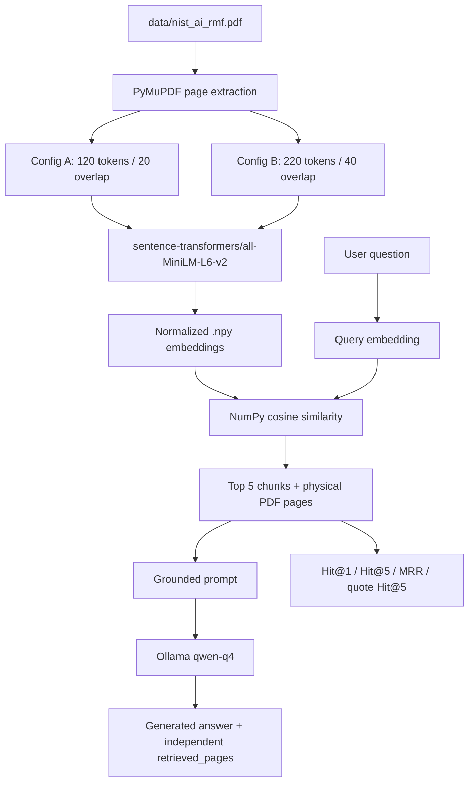

# Task 2: Framework-Free RAG

Minimal retrieval-augmented question answering over the NIST AI Risk Management Framework (AI RMF 1.0), implemented without LangChain, LlamaIndex, or a vector database.

## Objective

Build a working, measurable RAG experiment:

- ingest at least 30 pages of public technical documentation
- compare two tokenizer-measured chunk sizes
- retrieve with normalized MiniLM embeddings and NumPy cosine similarity
- generate answers only from retrieved evidence via a local Ollama model
- evaluate retrieval against 15 human-verified, page-grounded questions

## Architecture



## Document source

- File: [`data/nist_ai_rmf.pdf`](data/nist_ai_rmf.pdf)
- Title: Artificial Intelligence Risk Management Framework (AI RMF 1.0)
- Identifier: NIST AI 100-1
- URL: https://nvlpubs.nist.gov/nistpubs/ai/NIST.AI.100-1.pdf
- Physical PDF pages: **48** (all 48 have extractable text; 106,478 extracted characters)
- Citations use **physical PDF page numbers starting at 1**, not the printed footer numbers. Body text printed as "Page 1" is physical PDF page 6.
- Chunk counts after ingest: **213** (config A) and **126** (config B)

## Technologies

- Python 3.13
- PyMuPDF
- NumPy
- Sentence Transformers (`all-MiniLM-L6-v2`)
- requests
- Local Ollama (`qwen-q4` at `http://localhost:11434/api/generate`)
- Standard library only otherwise

No LangChain, LlamaIndex, Chroma, FAISS, Pinecone, frontend, or paid APIs.

## Chunking configurations

Chunks are confined to a single PDF page so page citations stay reliable.

| Config | Tokenizer tokens | Overlap | Chunks | Why compare |
| --- | ---: | ---: | ---: | --- |
| A | 120 | 20 | 213 | Shorter windows keep embeddings focused on one fact or definition. |
| B | 220 | 40 | 126 | Longer windows keep surrounding sentences, which can help multi-clause definitions. |

Both stay under MiniLM's 256-token limit after special tokens, so embeddings are not silently truncated. The same embedding model, normalization, cosine metric, and top-5 cutoff are used for both configs.

## Installation

```bash
python -m venv .venv
.venv\Scripts\activate
pip install -r requirements.txt
```

Ollama must be running locally with the `qwen-q4` model registered. Retrieval works without Ollama; generation does not.

## Usage

```bash
python run.py ingest
python run.py candidates
python run.py review
python run.py evaluate
python run.py ask "What are the four core functions of the AI RMF?"
python run.py test
python run.py status
```

## Retrieval results

Measured on **15 human-verified** questions in [`evaluation/gold_questions.csv`](evaluation/gold_questions.csv). Per-question ranks are in [`results/retrieval_results.csv`](results/retrieval_results.csv). Summary files:

- [`results/chunk_comparison.csv`](results/chunk_comparison.csv)
- [`results/evaluation_summary.json`](results/evaluation_summary.json)

| Config | Size / overlap | Hit@1 | Hit@5 | MRR | Quote Hit@5 |
| --- | --- | ---: | ---: | ---: | ---: |
| A | 120 / 20 | **0.533** (8/15) | **0.933** (14/15) | **0.706** | 0.600 (9/15) |
| B | 220 / 40 | **0.600** (9/15) | **0.933** (14/15) | **0.739** | 0.800 (12/15) |

On this verified set, config B matched config A on page-based Hit@5 and was higher on Hit@1, MRR, and quote Hit@5. That is a measured result for these 15 questions, not a general claim that larger chunks are always better.

### Metric definitions

- **Hit@1**: rank-1 chunk is from a gold supporting page.
- **Hit@5**: at least one top-5 chunk is from a gold supporting page.
- **MRR**: mean of 1/rank for the first gold-page chunk in the top 5, else 0.
- **Quote Hit@5**: the verified evidence quote occurs in at least one top-5 chunk.

Page-level matching is a proxy. A chunk can come from the correct page and still miss the supporting sentence. Quote Hit@5 is the stricter check; config A 0.600 vs Hit@5 0.933 shows that gap.

## Failure analysis

There was only **one unique Hit@5 miss** (Q14, both configs). The second case is a **Hit@1 miss and quote Hit@5 miss** (Q03, config A). No failed queries were invented.

### 1. Q14 — Hit@5 miss (configs A and B)

- **Question:** According to Appendix B, what privacy-related AI-specific risk is listed as new or increased compared with traditional software?
- **Gold page:** 43
- **Evidence:** “Privacy risk due to enhanced data aggregation capability for AI systems.”
- **Config A top-5 pages:** 22, 4, 44, 35, 17
- **Config B top-5 pages:** 44, 13, 4, 22, 22

Dense retrieval matched the word *privacy* to the Privacy-Enhanced chapter (page 22), MEASURE 2.10 (page 35), privacy/accuracy tradeoffs (page 17), the table of contents (page 4), and the next Appendix B page (page 44). The gold sentence is a short bullet inside a long list, so the chunk vector is dominated by neighboring items (pretrained models, drift, opacity) rather than *data aggregation*.

Larger chunks did not recover page 43. Config B ranked adjacent page 44 first — closer in the appendix, still the wrong bullets.

### 2. Q03 — Hit@1 miss and quote Hit@5 miss (config A)

- **Question:** In the context of the AI RMF, what does risk refer to?
- **Gold page:** 9
- **Config A top-5 pages:** 47, 9, 44, 15, 9 (Hit@5 succeeds; Hit@1 and quote fail)
- **Config B top-5 pages:** 9, 47, 15, 12, 1 (Hit@1 and quote succeed)

Rank 1 under 120-token chunks was Appendix D page 47 (“common language … to manage AI risks”), which shares *AI risk* wording but is not the Section 1.1 definition. Page 9 did enter the top 5, but the definition sentence was split across `A_p009_c00` and `A_p009_c01`, so neither retrieved chunk contained the full evidence quote. That is page-level Hit@5 overestimating evidence retrieval.

The 220-token window kept the definition intact and retrieved page 9 first. Larger chunks helped this question.

## How BM25 and reranking could improve retrieval

These are proposed improvements. They are **not implemented**.

- **BM25** ranks lexical overlap. It would help Q14 (`data aggregation`) and Q03 (`composite measure`) where MiniLM preferred thematically related pages.
- **Hybrid search** keeps both BM25 and dense candidates, covering exact wording and paraphrases.
- **Reciprocal Rank Fusion** merges those lists without calibrating cosine scores against BM25 scores.
- **Cross-encoder reranking** jointly encodes the question with each remaining chunk and is better at dropping nearby-but-wrong passages (Privacy-Enhanced vs Appendix B; Appendix D vs Section 1.1), at higher latency.

## Limitations

- Dense retrieval only; no lexical or hybrid index.
- Page-bounded chunks cannot join evidence that is split across pages without retrieving multiple chunks.
- Page-level Hit@k overestimates evidence retrieval (see Q03 config A).
- `qwen-q4` may still hallucinate citations; `retrieved_pages` from the retriever is the verified source list.
- Physical PDF pages differ from printed footer pages.
- 15 questions is a small, manually grounded set, not a published benchmark.

## Reproducibility

1. Keep [`data/nist_ai_rmf.pdf`](data/nist_ai_rmf.pdf) unchanged.
2. `python run.py ingest` extracts pages, builds both chunk configs, and caches normalized embeddings in `cache/`.
3. `python run.py candidates` rebuilds [`evaluation/gold_questions.csv`](evaluation/gold_questions.csv) from the extracted text and checks that each evidence quote occurs on the listed page.
4. Human-verify the 15 questions (`human_verified=true`).
5. `python run.py evaluate` uses identical retrieval settings for configs A and B and writes the `results/` files above.
6. `python run.py test` runs extraction, metric, ranking, and alignment checks.

Embeddings are cached. Pass `--force-embed` only if chunk text or the embedding model changes.
