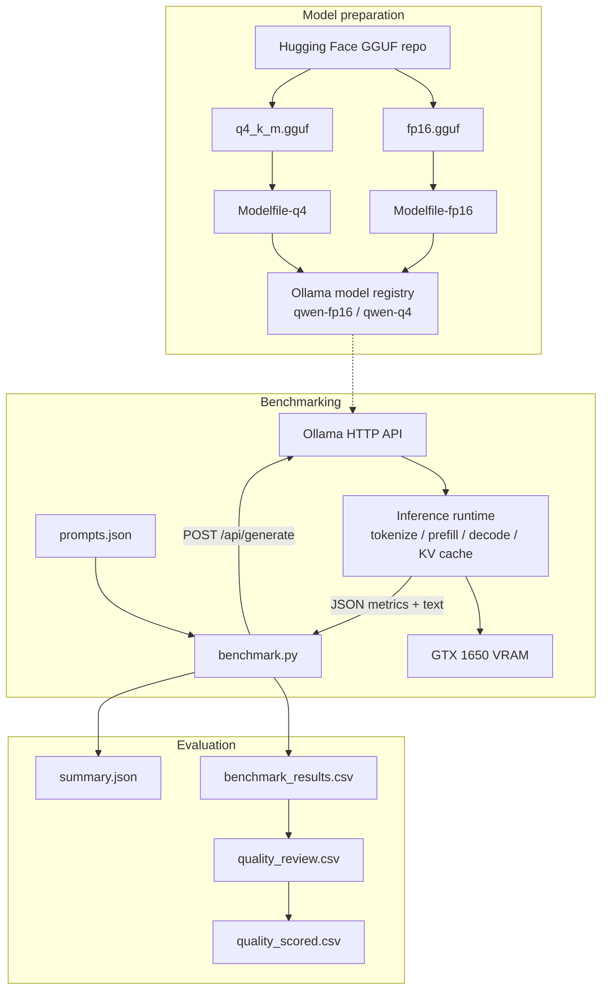
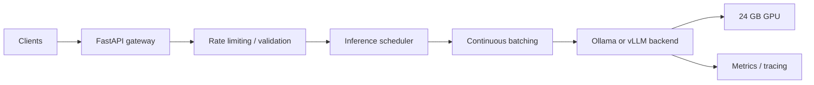

# LLM Inference & Quantization Benchmark

**TNDRR AI/ML Internship — Task 3**

Reproducible local inference benchmark comparing **FP16** and **Q4_K_M** weight precision for [Qwen2.5-0.5B-Instruct](https://huggingface.co/Qwen/Qwen2.5-0.5B-Instruct-GGUF), using **Ollama** (llama.cpp backend) on consumer hardware. This repository is an **experiment and documentation artifact**: benchmark controller, saved measurements, and manual quality review. It is **not** a fine-tuning pipeline, production inference service, or deployed application.

---

## Table of Contents

1. [Project objectives](#project-objectives)
2. [Key experimental findings](#key-experimental-findings)
3. [Technology stack and hardware](#technology-stack-and-hardware)
4. [Models and precision configurations](#models-and-precision-configurations)
5. [System architecture](#system-architecture)
6. [Experimental methodology](#experimental-methodology)
7. [Performance metrics](#performance-metrics)
8. [Benchmark results](#benchmark-results)
9. [Latency diagnostics](#latency-diagnostics)
10. [Quality evaluation](#quality-evaluation)
11. [Failure analysis](#failure-analysis)
12. [Secondary 256-token diagnostic](#secondary-256-token-diagnostic-not-part-of-main-benchmark)
13. [Inference concepts (engineering reference)](#inference-concepts-engineering-reference)
14. [Proposed deployment architecture (not implemented)](#proposed-deployment-architecture--not-implemented-or-load-tested) — full design: [docs/DEPLOYMENT_DESIGN.md](docs/DEPLOYMENT_DESIGN.md)
15. [Installation and reproduction](#installation-and-reproduction)
16. [Project structure](#project-structure)
17. [Experiment limitations](#experiment-limitations)
18. [Future work](#future-work)
19. [References](#references)

---

## Project objectives

| Goal | Status |
|------|--------|
| Run a small instruct model locally via Ollama | Completed |
| Compare FP16 vs 4-bit (Q4_K_M) inference | Completed (60 measured runs) |
| Measure throughput, latency, and GPU-reported memory | Completed — see [results/summary.json](results/summary.json) |
| Evaluate output quality on 10 diverse prompts | Completed with **provisional** manual scoring — see [results/quality_scored.csv](results/quality_scored.csv) |
| Document quantization and KV cache concepts | This README |
| Design serving 20 concurrent users on one 24 GB GPU | **Proposed** — see [docs/DEPLOYMENT_DESIGN.md](docs/DEPLOYMENT_DESIGN.md) (not implemented or load-tested) |

The **practical benchmark** ran on a **4 GB GTX 1650**. The **24 GB GPU** appears only in assignment prompts (e.g. P09) and in the **proposed** deployment section below—not as the hardware used for the 60-run experiment.

---

## Key experimental findings

Results are from the primary benchmark (`num_predict = 128`, 3 repetitions × 10 prompts × 2 models). Source: [results/summary.json](results/summary.json), [results/benchmark_results.csv](results/benchmark_results.csv).

| Metric | `qwen-fp16` | `qwen-q4` (Q4_K_M) |
|--------|------------:|-------------------:|
| Measured requests | 30 | 30 |
| Aggregate generation throughput | **84.88** tok/s | **69.00** tok/s |
| Median end-to-end latency (wall clock) | **2.528 s** | **2.574 s** |
| Ollama-reported GPU allocation (`size_vram`) | **1003.94 MiB** | **435.22 MiB** |
| Responses truncated at output limit (`done_reason=length`) | 6 | 3 |

**Throughput:** FP16 achieved ~**23.0%** higher aggregate generation throughput than Q4_K_M on this setup:

\[
\frac{84.88 - 69.00}{69.00} \approx 23.0\%
\]

**Memory:** Q4_K_M reduced reported GPU allocation by ~**56.6%** vs FP16:

\[
\frac{1003.94 - 435.22}{1003.94} \approx 56.6\%
\]

**Latency:** Median wall-clock latency differed by ~**46 ms** (2.574 − 2.528). That gap is **not** the inverse of the throughput gap: throughput measures **decode-stage token rate**; latency includes **HTTP, scheduling, prefill, load bookkeeping, and variable output length**.

**Takeaway for this machine:** Q4_K_M **saved VRAM**; it did **not** win on **decode throughput** or **median latency** here. That outcome is **hardware- and runtime-specific** (quantized kernel paths, unpacking, bandwidth, Ollama/llama.cpp build)—not a universal law that FP16 is always faster or Q4 always slower.

---

## Technology stack and hardware

| Component | Configuration |
|-----------|----------------|
| OS | Windows 11 |
| GPU | NVIDIA GeForce GTX 1650 |
| GPU VRAM | 4 GB (4,096 MiB) |
| NVIDIA driver | 529.04 |
| Python | 3.13.1 |
| Environment manager | [uv](https://github.com/astral-sh/uv) |
| Ollama | 0.40.16 |
| Inference API | Ollama HTTP (`/api/generate`, `/api/ps`, `/api/version`) |
| HTTP client | `requests` |
| Base model | Qwen2.5-0.5B-Instruct |
| On-disk format | GGUF (pre-quantized artifacts from Hugging Face) |
| Backend | Ollama / llama.cpp (transformer math **not** executed in Python) |

Inference numbers **will not transfer unchanged** to other GPUs, drivers, Ollama versions, or batching setups.

---

## Models and precision configurations

Both variants are the **same pretrained model family** with different **stored numerical precision** of weights. Comparing two unrelated LLMs would confound accuracy and speed with architecture, tokenizer, and training differences.

### Model A — FP16

| Field | Value |
|-------|--------|
| Hugging Face repo | [Qwen/Qwen2.5-0.5B-Instruct-GGUF](https://huggingface.co/Qwen/Qwen2.5-0.5B-Instruct-GGUF) |
| GGUF file | `models/qwen2.5-0.5b-instruct-fp16.gguf` |
| File size | **1,266,425,696** bytes (~1.18 GiB) |
| Ollama name | `qwen-fp16` |
| Modelfile | [Modelfile-fp16](Modelfile-fp16) |

### Model B — Q4_K_M

| Field | Value |
|-------|--------|
| GGUF file | `models/qwen2.5-0.5b-instruct-q4_k_m.gguf` |
| File size | **491,400,032** bytes (~469 MiB) |
| Ollama name | `qwen-q4` |
| Modelfile | [Modelfile-q4](Modelfile-q4) |

**On-disk size reduction (FP16 → Q4_K_M):**

\[
\frac{1{,}266{,}425{,}696 - 491{,}400{,}032}{1{,}266{,}425{,}696} \approx 61.2\%
\]

The Q4_K_M file is ~**38.8%** of the FP16 file size by bytes.

### Concepts

- **Model weights:** Learned parameters (matrices) applied during the forward pass. At inference, weights are **read**, not updated.
- **FP16:** 16-bit floating-point storage for weights (and often activations). Higher fidelity, larger memory footprint.
- **Quantization:** Map high-precision weights to lower-bit codes plus scales/zero-points (or similar). Reduces memory and bandwidth; introduces approximation error that can change token probabilities **without retraining**.
- **Q4_K_M:** A **4-bit** llama.cpp quantization scheme with mixed block types (“K-quants”); `_K_M` is a **medium** size/quality tradeoff among K variants.
- **GGUF:** Single-file container for weights and metadata, suited to llama.cpp/Ollama local loading.
- **Numerical precision ≠ answer accuracy:** A smaller file or fewer bits does not automatically mean worse reasoning on every prompt—or better speed. Accuracy depends on task, quantization damage, and decoding constraints (e.g. token limit).

**Important:** We **downloaded** already-quantized GGUF files. This project did **not** implement or run a custom quantization training/calibration pipeline.

---

## System architecture

Python orchestrates HTTP calls; **Ollama** loads GGUF tensors, runs tokenization, prefill, autoregressive decoding, KV-cache growth, and GPU kernels.



### Request lifecycle (as implemented)

1. Load evaluation prompts from [prompts.json](prompts.json).
2. For each model: `ollama stop` the other variant; **warm-up** one throwaway generation.
3. Snapshot loaded-model memory via `GET /api/ps`.
4. For each prompt × 3 runs: `POST /api/generate` with fixed `options` (see [benchmark.py](benchmark.py)).
5. Ollama loads or reuses weights (`keep_alive: 30m`), tokenizes, runs **prefill**, then **autoregressive decode** with growing **KV cache**.
6. Response JSON supplies `eval_count`, `eval_duration`, `prompt_eval_duration`, `load_duration`, `done_reason`, etc.; Python adds **wall time** via `time.perf_counter()`.
7. Rows appended to CSV; aggregates written to `summary.json`.

### Why Python is not the compute engine

The benchmark never multiplies weight matrices in NumPy/PyTorch. It is a **controller**: reproducible prompts, isolation, timing wrappers, and persistence. Numerical work happens inside Ollama’s llama.cpp stack on the GPU (for this model size and reported `size_vram`).

---

## Experimental methodology

Parameters are defined in [benchmark.py](benchmark.py) (`OPTIONS`, `REPETITIONS`, `MODELS`).

| Parameter | Value | Purpose |
|-----------|-------|---------|
| Models | `qwen-fp16`, `qwen-q4` | Same architecture, different weight precision |
| Prompts | 10 | Task diversity — see [prompts.json](prompts.json) |
| Repetitions | 3 per prompt per model | **60** total measured requests |
| `num_ctx` | 2048 | Max context window |
| `num_predict` | 128 | **Primary** max output tokens |
| `temperature` | 0 | Greedy/low-entropy decoding |
| `seed` | 42 | Reproducibility hint (not a guarantee across precisions/builds) |
| Execution | Sequential | One request at a time |
| API | `POST /api/generate`, `stream: false` | Single JSON response per call |
| Warm-up | Yes, before timed loop | Separates cold-start effects from steady state |
| Model isolation | `unload_models()` between variants | Avoid two models resident in VRAM |

### Warm-up

First inference after load can pay **model load**, **graph setup**, and **cache** costs. The script runs one warm-up generation per model **before** recording the 30 runs, so the measured loop is closer to **steady-state** inference (though load/prompt/decode components still vary per request).

### Model isolation

Before benchmarking each variant, both models are stopped so the other’s weights are not competing for VRAM or runtime state.

### Controlled comparison

Identical prompts, context limit, output cap, temperature, seed, hardware, and Ollama version keep comparisons focused on **weight precision** rather than decoding policy or dataset drift.

### Repetitions

Three runs per prompt reduce variance from timer noise and runtime jitter but remain a **small sample**—not a substitute for confidence intervals or large test sets.

### Determinism

`temperature: 0` and `seed: 42` reduce randomness. They do **not** guarantee bitwise-identical outputs across FP16 vs Q4, Ollama updates, or different GPUs.

---

## Performance metrics

### Per-request generation throughput (Ollama)

Ollama returns `eval_duration` in **nanoseconds**. The benchmark computes:

\[
\text{tokens\_per\_second} = \frac{\text{eval\_count}}{\text{eval\_duration} / 10^9}
\]

This is **output-token decode throughput** for that request—not tokens including prompt, and not full request throughput.

### Aggregate throughput (summary)

More stable when some responses are very short:

\[
\text{aggregate\_tps} = \frac{\sum \text{output\_tokens}}{\sum \text{decode\_seconds}}
\]

Implemented in `summarize()` in [benchmark.py](benchmark.py).

### End-to-end latency

`wall_seconds` = elapsed time from immediately before `requests.post` until the HTTP response body is received (`time.perf_counter()`). Includes network loopback, Ollama queueing, prefill, decode, and serialization—not just GPU matmul time.

### Prompt processing (prefill)

`prompt_eval_duration` (ns → `prompt_eval_seconds`): processing **input** tokens to populate initial states and KV entries before decode.

### Model loading

`load_duration`: time attributed to load/reload bookkeeping for that request (often small after warm-up).

### Memory (do not conflate)

| Quantity | Meaning in this project |
|----------|-------------------------|
| GGUF file size | On-disk bytes; **not** peak VRAM |
| Ollama `size` / `loaded_size_mib` | Loaded model footprint reported by Ollama |
| `size_vram` → `gpu_memory_mib` | **GPU-resident portion** Ollama reports for the loaded model |
| KV cache | Grows with context and generated tokens; part of runtime memory, not the GGUF file |
| Temp buffers | Activations, scratch—add to peak beyond static weights |

`gpu_memory_mib` in the CSV is sampled once after warm-up via `/api/ps`; it is **not** a continuous peak-memory trace across the full request. **`size_vram` is not total peak GPU usage** for the whole machine—only Ollama’s reported VRAM for the loaded weights/runtime associated with that model entry.

---

## Benchmark results

### Summary table

Validated against [results/summary.json](results/summary.json).

| Metric | FP16 | Q4_K_M |
|--------|-----:|-------:|
| Runs | 30 | 30 |
| Aggregate generation throughput (tok/s) | 84.88 | 69.00 |
| Median wall latency (s) | 2.528 | 2.574 |
| GPU allocation (MiB) | 1003.94 | 435.22 |
| Truncations at 128 tokens | 6 | 3 |

### Interpretation

- **Q4_K_M** clearly reduced **reported VRAM** for loaded weights—expected from 4-bit storage.
- **FP16** achieved higher **aggregate decode throughput** here. Hypotheses (not profiled in this repo): dequantization overhead in Q4 kernels on GTX 1650, memory bandwidth vs compute balance, and Ollama build flags. Treat as **hypotheses** until kernel-level profiling is added.
- **Median wall latency** was nearly equal; Q4 was slightly slower by ~46 ms despite fewer median output tokens (see diagnostics), so **latency and throughput need not move in the same direction**.

Both variants reported non-zero `size_vram` on this hardware, consistent with GPU-resident inference for this model on a 4 GB card—not a claim of “100% GPU layer offload” without layer-split logs.

---

## Latency diagnostics

Medians computed from [results/benchmark_results.csv](results/benchmark_results.csv) (30 rows per model).

| Metric (median) | FP16 | Q4_K_M |
|-----------------|-----:|-------:|
| `load_seconds` | 0.0089 | 0.0095 |
| `prompt_eval_seconds` | 0.0237 | 0.0432 |
| `decode_seconds` | 0.3657 | 0.4331 |
| `wall_seconds` | 2.5276 | 2.5736 |
| `output_tokens` | 26.5 | 22.0 |

### Unresolved observation

Summing medians of internal components (~0.4 s) is **far below** median **wall** time (~2.5 s). The **root cause is not established** in this repository. Possibilities worth future investigation (not confirmed): HTTP/client overhead not in Ollama’s internal timers, first-run effects within repetitions, `keep_alive` and scheduling, Windows timer vs engine accounting, or other work outside `eval_duration` / `prompt_eval_duration`.

**Caution:** Medians of components **cannot** be added and compared directly to the median of total latency.

---

## Quality evaluation

Runtime metrics do not measure instruction-following or factual correctness. Ten prompts in [prompts.json](prompts.json) cover:

| ID | Category |
|----|----------|
| P01 | Factual QA |
| P02 | Arithmetic |
| P03 | Logical reasoning |
| P04 | Structured JSON |
| P05 | Python one-liner |
| P06 | Summarization (≤15 words) |
| P07 | Information extraction (JSON) |
| P08 | Instruction following (sorting) |
| P09 | Numerical reasoning |
| P10 | Technical explanation (KV cache) |

### Rubric (0–2)

| Score | Meaning |
|-------|---------|
| 0 | Incorrect, unusable, or incomplete |
| 1 | Partially correct or content OK with meaningful format/instruction violation |
| 2 | Correct, complete, follows instructions |

### Scoring status

- [results/quality_review.csv](results/quality_review.csv): responses **without** scores (template).
- [results/quality_scored.csv](results/quality_scored.csv): **one row per prompt × model** (first benchmark response per pair), scores filled with `review_notes` = **“Provisional review; verify against rubric”**.

**Provisional totals** from `quality_scored.csv` (max 20 per model):

| Model | Total score | Notes |
|-------|------------:|-------|
| `qwen-fp16` | **7** / 20 | |
| `qwen-q4` | **8** / 20 | |

These are **not finalized experimental conclusions** until independently verified. Ten prompts cannot establish general superiority of either precision for **accuracy**.

---

## Failure analysis

Examples below reference the stored responses in [results/quality_scored.csv](results/quality_scored.csv) and [results/benchmark_results.csv](results/benchmark_results.csv) (**128-token** main benchmark).

### Failure 1 — FP16 truncation on P02 (arithmetic)

**Prompt:** 240 requests in 8 seconds → throughput in req/s.  
**Expected:** 30 req/s.

FP16 produced a long step-by-step explanation and hit `done_reason=length` at **128 tokens** before stating the final answer. Q4 completed with **96 tokens** and the correct **30 requests per second**.

**Classification:** **Output truncation / completion budget**, not proof that FP16 cannot divide 240 by 8.

### Failure 2 — P09 (GPU memory arithmetic)

**Expected:** \(24 - (6 + 2) = 16\) GB.

- FP16: correct setup, **truncated** at 128 tokens before the final number.
- Q4: used **Remaining = Total required − Available** with values \(8 - 24\), heading toward a negative result—**reasoning error**, plus truncation.

### Failure 3 — P03 (logical reasoning)

Both answered **Yes** (FP16 with flawed explanation; Q4 with bare “Yes.”). From “All servers are computers” and “Some computers are laptops,” **no valid syllogism** forces some servers to be laptops. **Correct answer: No.**

**Classification:** **Reasoning failure** on both variants.

### Failure 4 — JSON formatting (P04, P07)

Both returned **Markdown-fenced** JSON. Extracted fields were right; **strict “raw JSON only”** was violated.

**Classification:** **Formatting / instruction-following** (score 1 in provisional rubric).

### Failure 5 — P08 (sorting)

Both returned `cache, batch, latency, token` instead of **`batch, cache, latency, token`**.

**Classification:** **Instruction-following failure** (score 0).

### P10 — KV cache explanation

- FP16: long text, used forbidden word “faster,” not exactly two sentences.
- Q4: conflated KV cache with generic key-value storage and **training**; instruction violations.

**Classification:** Mix of **conceptual error**, **format**, and **instruction** failures.

---

## Secondary 256-token diagnostic (not part of main benchmark)

A **separate** follow-up used `num_predict = 256` for **P02** and **P09** only. Results were **manually recorded** and are **not** stored as a dedicated results file in this repository.

| Model | Prompt | Output tokens (observed) | Outcome |
|-------|--------|-------------------------:|---------|
| FP16 | P02 | 214 | Correct: 30 req/s |
| FP16 | P09 | 204 | Correct: 16 GB |
| Q4_K_M | P02 | 96 | Correct: 30 req/s |
| Q4_K_M | P09 | 192 | Incorrect: −16 GB |

**Lessons:**

- Raising the token budget let **FP16 finish** both calculations—supports truncation as a driver for P02/P09 FP16 failures at 128 tokens.
- Q4 **still failed** P09 arithmetically at 256 tokens—suggests a **reasoning** issue distinct from truncation alone.
- Do **not** merge these numbers into the 128-token throughput/latency summary.

---

## Inference concepts (engineering reference)

| Term | Short explanation |
|------|-------------------|
| **Weights** | Frozen parameters; linear layers use them to map hidden states. |
| **Numerical precision** | Bit width and encoding of those parameters (FP16 vs 4-bit blocks). |
| **Quantization** | Compress weights; decode may dequantize on the fly; logits can shift slightly. |
| **GGUF** | Packaged tensors + metadata for local llama.cpp loaders. |
| **Tokenization** | Text → token IDs (model-specific vocab). |
| **Prefill** | One forward pass over the prompt to build KV states. |
| **Autoregressive decoding** | Generate one token at a time; each step attends over prior tokens via KV cache. |
| **KV cache** | Stored attention keys/values for past positions; memory grows with sequence length × layers × batch. |
| **GPU memory** | Weights + KV + activations + framework buffers; file size is only the first term. |
| **Throughput vs latency** | High tok/s during decode can coexist with long wall time if prefill, load, or I/O dominate, or outputs are long. |

---

## Proposed deployment architecture — not implemented or load-tested

Assignment ask: serve **20 concurrent users** on **one 24 GB GPU**. **No FastAPI service, vLLM deployment, or load test is implemented in this repo.** Capacity planning, KV-cache math, and a proposed FastAPI + vLLM architecture are documented in **[docs/DEPLOYMENT_DESIGN.md](docs/DEPLOYMENT_DESIGN.md)** (proposed design only—not validated on a 24 GB GPU).

The summary diagram below matches that document at a high level; see the linked file for formulas, memory budgets, monitoring, and a load-test plan.



**Design intent (conceptual):**

- Separate **concurrent TCP connections** from **simultaneous active decode sequences**.
- **Continuous batching** to improve GPU utilization under many streams.
- **Memory budget:** weight precision + per-sequence KV × concurrent sequences + overhead; Q4 weights free VRAM for more KV/headsroom on the same card.
- **Streaming responses** for perceived latency; **observability** on queue depth, p95 latency, and OOM guards.
- For 0.5B-class models on 24 GB, many concurrent **small-context** chats may fit; exact **20-user** sizing requires measured KV growth, context limits, and chosen backend—**not** extrapolated from this single-user GTX 1650 benchmark.

---

## Installation and reproduction

### Prerequisites

- Windows 11, NVIDIA GPU with working drivers
- [Ollama](https://ollama.com/) installed (tested: 0.40.16)
- [uv](https://github.com/astral-sh/uv) and Python 3.13.1
- Disk space for ~1.8 GB of GGUF files under `models/` (git-ignored in practice)

### 1. Clone or open the repository

```powershell
cd "E:\AI-ML ENGINEERING\Company-Assgnment-Projects\Tndrr-Task-1,2,&3\Task-3-Running-Model-Locally-Optimization-LLM-Inferrence"
```

### 2. Python environment

```powershell
uv venv --python 3.13.1 .venv
.\.venv\Scripts\Activate.ps1
uv pip install -r requirements.txt
```

[requirements.txt](requirements.txt) pins `requests` (required by [benchmark.py](benchmark.py)) and `huggingface_hub` (optional, for GGUF downloads only).

### 3. Download GGUF weights

From [Qwen/Qwen2.5-0.5B-Instruct-GGUF](https://huggingface.co/Qwen/Qwen2.5-0.5B-Instruct-GGUF):

- `qwen2.5-0.5b-instruct-fp16.gguf`
- `qwen2.5-0.5b-instruct-q4_k_m.gguf`

Place them in `models/` (paths referenced by the Modelfiles).

Example (Hugging Face CLI):

```powershell
huggingface-cli download Qwen/Qwen2.5-0.5B-Instruct-GGUF `
  qwen2.5-0.5b-instruct-fp16.gguf `
  --local-dir .\models
huggingface-cli download Qwen/Qwen2.5-0.5B-Instruct-GGUF `
  qwen2.5-0.5b-instruct-q4_k_m.gguf `
  --local-dir .\models
```

### 4. Register Ollama models

From the repository root (so relative `FROM ./models/...` resolves):

```powershell
ollama create qwen-fp16 -f .\Modelfile-fp16
ollama create qwen-q4 -f .\Modelfile-q4
ollama list
```

**Troubleshooting (Windows):** If `ollama` is not on `PATH`, call the executable directly, e.g. `%LOCALAPPDATA%\Programs\Ollama\ollama.exe` (this matches `OLLAMA_EXE` in [benchmark.py](benchmark.py)).

**Model storage:** Setting `OLLAMA_MODELS` does not always relocate every Ollama artifact on Windows; registrations may still reference copies under `%USERPROFILE%\.ollama`. The Modelfile `FROM` path still points at this repo’s `models/` GGUF files.

### 5. Smoke test

```powershell
ollama run qwen-fp16 "Say hello in one word."
ollama ps
```

### 6. Run the benchmark

Ensure the Ollama server is running, then:

```powershell
python benchmark.py
```

Outputs:

- [results/benchmark_results.csv](results/benchmark_results.csv) — per-run rows
- [results/summary.json](results/summary.json) — aggregates

Quality CSVs are maintained separately from the benchmark script.

### What not to commit

Large binaries and local environments are listed in [.gitignore](.gitignore), including:

- `models/` and `*.gguf` (re-download per instructions above)
- `.venv/`
- Secrets (`.env`, etc.)

---

## Project structure

```text
Task-3-Running-Model-Locally-Optimization-LLM-Inferrence/
├── benchmark.py              # Benchmark controller
├── prompts.json              # 10 evaluation prompts
├── Modelfile-fp16            # Ollama recipe → qwen-fp16
├── Modelfile-q4              # Ollama recipe → qwen-q4
├── models/                   # Local GGUF weights (not in git)
│   ├── qwen2.5-0.5b-instruct-fp16.gguf
│   └── qwen2.5-0.5b-instruct-q4_k_m.gguf
├── docs/
│   └── DEPLOYMENT_DESIGN.md  # Proposed 20-user / 24 GB GPU design (not load-tested)
├── results/
│   ├── benchmark_results.csv # 60-run primary benchmark
│   ├── summary.json          # Aggregate metrics
│   ├── quality_review.csv    # Responses without scores
│   └── quality_scored.csv    # Provisional manual scores
├── requirements.txt          # Python dependencies (pinned)
├── .gitignore                # Excludes .venv, models/, caches
├── .venv/                    # Local virtualenv (not for git)
└── README.md                 # This document
```

**Not in repo:** production inference service, FastAPI/vLLM implementation, or multi-user load tests.

---

## Experiment limitations

- Single **GTX 1650** (4 GB)—results do not describe a 24 GB server GPU.
- One **model family** (0.5B instruct), two **weight formats** only.
- **10 prompts**, **3** repetitions—limited statistical power.
- Quality scores: **manual**, **provisional**, one response per prompt×model in `quality_scored.csv`.
- Fixed **`num_predict=128`** strongly affects long chain-of-thought style answers.
- **Sequential** requests only—no concurrent load or continuous batching measurement.
- No **kernel-level profiling** (Nsight, llama.cpp perf counters).
- **Wall vs internal timing gap** unresolved.
- No formal **significance tests** on throughput or latency differences.
- Ollama version, llama.cpp build, and driver stack tightly couple to observed Q4 vs FP16 **speed** ranking.

---

## Future work

Possible extensions (not implemented):

- Longer output caps and separate **prefill vs decode** reporting
- Broader prompt suite or external eval sets; automated JSON schema checks
- Additional quant formats (Q5_K_M, Q8_0, IQ variants) on the same GGUF hub
- Finer timing (client-side spans, Ollama debug, GPU memory sampling per request)
- **Concurrent** and **batched** benchmarks (vLLM, llama.cpp server, Ollama batch APIs)
- Repeat on **24 GB** hardware to validate [docs/DEPLOYMENT_DESIGN.md](docs/DEPLOYMENT_DESIGN.md)
- Finalize quality review pipeline and remove “provisional” status
- Implement proposed FastAPI + vLLM stack and execute the deployment load-test plan

---

## References

- [Qwen2.5-0.5B-Instruct-GGUF](https://huggingface.co/Qwen/Qwen2.5-0.5B-Instruct-GGUF)
- [Ollama API](https://github.com/ollama/ollama/blob/main/docs/api.md)
- [llama.cpp GGUF / quantization](https://github.com/ggerganov/llama.cpp)
- Project artifacts: [benchmark.py](benchmark.py), [results/summary.json](results/summary.json), [results/benchmark_results.csv](results/benchmark_results.csv), [results/quality_scored.csv](results/quality_scored.csv), [docs/DEPLOYMENT_DESIGN.md](docs/DEPLOYMENT_DESIGN.md)

---

*Document generated to match the implemented benchmark and saved results. For assignment context: compare precision formats on real hardware, report honest limitations, and separate measured performance from proposed production design.*