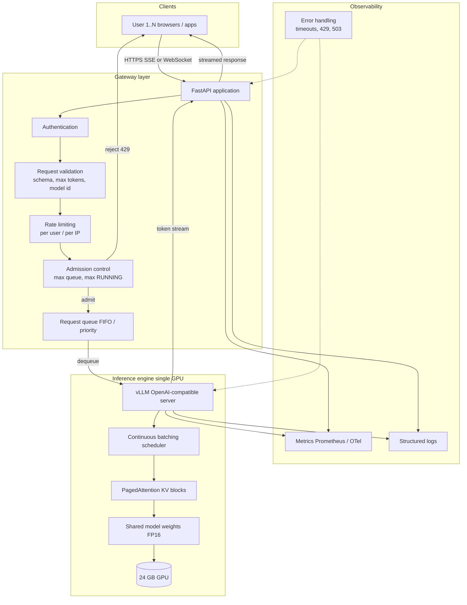
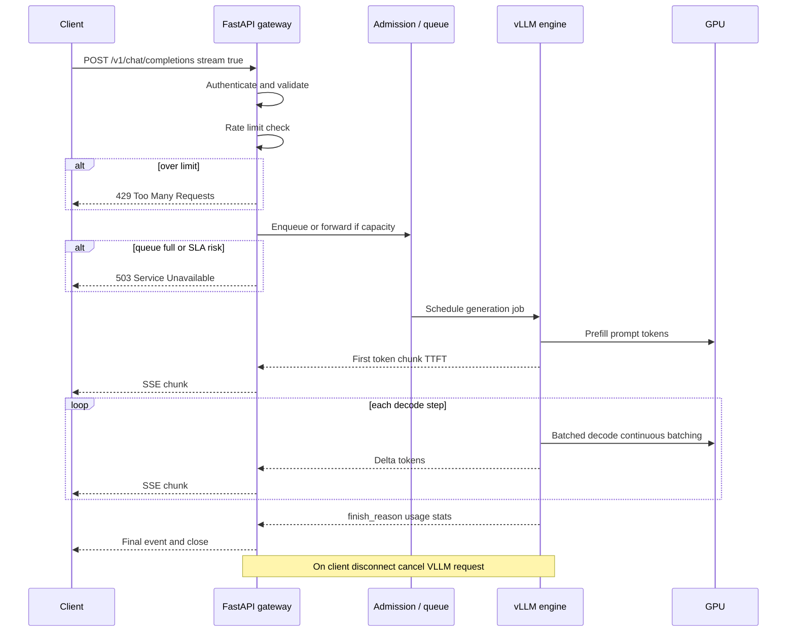

# Proposed Deployment Design: 20 Concurrent Users on One 24 GB GPU

**Assignment:** TNDRR AI/ML Internship — Task 3  
**Status:** **Proposed architecture and capacity analysis only.** Not implemented, not load-tested, and not validated on production hardware.

This document complements the local [Ollama](../README.md) benchmark on a **4 GB GTX 1650**. That experiment ([`benchmark.py`](../benchmark.py), [`results/summary.json`](../results/summary.json)) measured **sequential**, single-client inference. It does **not** predict multi-user behavior on a **24 GB** server GPU without a separate serving stack and load tests.

| Related artifact | Role |
|----------------|------|
| [`prompts.json`](../prompts.json) | Quality evaluation prompts (`num_ctx` design point = 2048 in benchmark) |
| [`Modelfile-fp16`](../Modelfile-fp16) / [`Modelfile-q4`](../Modelfile-q4) | Ollama + GGUF only |
| [`results/summary.json`](../results/summary.json) | Single-stream FP16 ~84.88 tok/s aggregate decode (reference only) |

---

## 1. Problem statement and assumptions

### 1.1 Problem

Design a **conceptual** serving path that can accept load from **20 concurrent users** while hosting **Qwen2.5-0.5B-Instruct** on **one GPU with ~24 GB of memory**, with acceptable latency and reliability under stated assumptions.

### 1.2 Explicit scope boundary

| In scope | Out of scope (this repo today) |
|----------|--------------------------------|
| Architecture, memory math, tuning knobs | FastAPI / vLLM code in this repository |
| KV-cache budgeting for 20 active sequences | Measured 20-user load test |
| Load-test **plan** and pass/fail criteria | Guaranteed p95 latency or SLA |

### 1.3 Hardware and model assumptions

| Assumption | Value | Notes |
|------------|-------|--------|
| GPU | **One** card, **24 GB** nominal capacity | See §4 for decimal GB vs GiB |
| Model | [Qwen2.5-0.5B-Instruct](https://huggingface.co/Qwen/Qwen2.5-0.5B-Instruct) | Same family as local GGUF benchmark |
| Initial weight precision | **FP16** (or BF16 in HF weights) for serving baseline | Quantization discussed as trade-off only |
| Context per active sequence (baseline) | **Up to 2,048 tokens** | Matches benchmark `num_ctx` in [`benchmark.py`](../benchmark.py) |
| Concurrent users (target) | **20** | Design target, not proven capacity |

Architecture verified from official Hugging Face `config.json`:

| Config field | Value |
|--------------|------:|
| `num_hidden_layers` | 24 |
| `num_attention_heads` | 14 |
| `num_key_value_heads` | 2 (GQA) |
| `hidden_size` | 896 |
| Head dimension | \(896 / 14 = 64\) |
| `max_position_embeddings` | 32768 |

Source: [Qwen2.5-0.5B-Instruct config.json](https://huggingface.co/Qwen/Qwen2.5-0.5B-Instruct/raw/main/config.json).

### 1.4 Concurrency vocabulary

These terms are **not interchangeable**:

| Term | Meaning |
|------|---------|
| **Connected users** | Clients with open HTTP/WebSocket connections (may be idle). |
| **Queued requests** | Requests admitted by the API but **not yet decoding** on GPU (waiting in scheduler queue). |
| **Actively decoding sequences** | Requests in **RUNNING** state: prefill and/or autoregressive decode using KV cache and compute. |

A design for “20 concurrent users” must specify whether the limit applies to **connections**, **admitted requests**, or **simultaneous RUNNING sequences** (e.g. `max_num_active_seqs` / `max_num_seqs` in vLLM). This document budgets memory for **20 actively decoding sequences**, each holding up to the sequence lengths in §3.

### 1.5 Workload assumptions (illustrative)

| Parameter | Baseline assumption |
|-----------|---------------------|
| Mixed prefill + decode | Typical chat: short user messages, streaming assistant replies |
| Output length | Variable; throughput examples use per-user token rates, not fixed `num_predict` |
| Authentication | Required at gateway (API keys or OIDC) |
| Multi-tenancy | Single model replica on one GPU |

---

## 2. Complete architecture

### 2.1 Component responsibilities



### 2.2 Request and response flow



### 2.3 Layer-by-layer description

| Layer | Function |
|-------|----------|
| **Clients** | Chat UI or API consumers; use streaming to improve perceived latency. |
| **FastAPI gateway** | Public HTTP API, OpenAI-compatible routes optional; maps auth identity to quotas. |
| **Authentication** | Reject unauthenticated traffic before GPU work. |
| **Request validation** | Enforce `max_tokens`, context length, allowed models, JSON/tool schemas. |
| **Rate limiting** | Token bucket or sliding window per user; protects against abuse. |
| **Admission control** | Caps queue depth and RUNNING sequences; returns 429/503 instead of OOM. |
| **Request queue** | Buffers burst traffic; fairness policy (FIFO vs priority tiers) is a product choice. |
| **vLLM** | High-throughput LLM server with continuous batching and PagedAttention ([vLLM project](https://docs.vllm.ai/)). |
| **Continuous batching** | Adds/removes sequences across forward passes; improves GPU utilization vs static batching. |
| **Paged KV cache** | KV stored in fixed-size blocks; reduces fragmentation vs one contiguous buffer per sequence. |
| **Shared weights** | **One** model copy on GPU; all sequences share the same parameters. |
| **Streaming** | Tokens forwarded as generated; TTFT tracked separately from inter-token latency. |
| **Metrics and reliability** | TTFT, throughput, queue depth, VRAM, errors; client timeouts and cancellation. |

---

## 3. KV-cache calculation

### 3.1 Formula (GQA, separate K and V)

For each sequence, storing keys and values for all layers:

\[
\text{KV bytes (one sequence)} = 2 \times L \times H_{kv} \times d_{head} \times S \times b
\]

| Symbol | Meaning | Qwen2.5-0.5B value |
|--------|---------|-------------------:|
| \(2\) | Key cache + value cache | — |
| \(L\) | Transformer layers | 24 |
| \(H_{kv}\) | KV heads (GQA) | 2 |
| \(d_{head}\) | Head dimension | 64 |
| \(S\) | Sequence length (tokens in cache: prompt + generated) | scenario-dependent |
| \(b\) | Bytes per element (FP16) | 2 |

**Per token, one sequence:**

\[
2 \times 24 \times 2 \times 64 \times 2 = 12{,}288 \text{ bytes/token}
\]

**Twenty actively decoding sequences** at the same logical length \(S\):

\[
\text{KV total} = 20 \times 12{,}288 \times S \text{ bytes}
\]

### 3.2 Verified totals (theoretical raw KV tensors)

These figures are **analytic upper bounds for KV tensor storage** in FP16. They **exclude** paging metadata, alignment, CUDA context, activations, and vLLM block overhead.

| Sequence length \(S\) (per active seq.) | KV for 20 sequences (bytes) | KV (GiB, \(1024^3\)) |
|----------------------------------------:|----------------------------:|---------------------:|
| 2,048 | 503,316,480 | **0.469** |
| 8,192 | 2,013,265,920 | **1.875** |
| 32,768 | 8,053,063,680 | **7.500** |

Derivation check ( \(S = 2048\) ):

\[
20 \times 12{,}288 \times 2048 = 503{,}316{,}480 \text{ bytes} \approx 0.469 \text{ GiB}
\]

### 3.3 Relationship to `max_model_len` and vLLM

- Hugging Face `max_position_embeddings` is **32768** for this model; serving `max_model_len` should be ≤ that and aligned with product limits.
- vLLM sizes KV from **block tables** and **gpu_memory_utilization** (or explicit KV bytes), not from this closed-form alone. See [vLLM optimization — GPU memory](https://docs.vllm.ai/en/stable/configuration/optimization/) and [engine arguments](https://docs.vllm.ai/en/stable/configuration/engine_args/).

---

## 4. GPU memory budget

### 4.1 Nominal capacity: decimal GB vs GiB

GPUs are often marketed as **24 GB** using decimal conventions. Convert to **GiB** before comparing with tool reports:

\[
24 \times 10^9 \text{ bytes} \div 2^{30} \approx \mathbf{22.35} \text{ GiB}
\]

Always confirm whether `nvidia-smi` and the serving framework report MiB/GiB consistently.

### 4.2 Illustrative stack budget (FP16 weights, 20 active sequences)

**Fixed illustrative components** (not measured on a 24 GB host in this project):

| Component | Assumption (GiB) | Role |
|-----------|----------------:|------|
| Model weights | **1.2** | ~0.5B params × 2 bytes ≈ 1 GB + small overhead; aligns with ~1.18 GiB on-disk FP16 GGUF in the local benchmark |
| Runtime and safety reserve | **4.0** | CUDA context, cuBLAS/cuDNN, peak activations, paging metadata, fragmentation headroom, driver ECC if enabled |
| KV cache (20 × \(S\)) | §3.2 | Grows with context |

**Total allocated (illustrative)** = weights + reserve + KV:

| Per-sequence length \(S\) | KV (GiB) | **Total used (GiB)** | **Remaining from 24 GiB nominal** |
|--------------------------:|---------:|---------------------:|----------------------------------:|
| 2,048 | 0.469 | **5.669** | **18.331** |
| 8,192 | 1.875 | **7.075** | **16.925** |
| 32,768 | 7.500 | **12.700** | **11.300** |

If the **physical** ceiling is **22.35 GiB** instead of 24 GiB, subtract ~**1.65 GiB** from each “remaining” row before trusting headroom.

### 4.3 What each memory category means

| Category | Description |
|----------|-------------|
| **Weights** | Static parameters; one copy shared across users (tensor parallel not used here). |
| **KV cache** | Per-sequence attention state; grows with tokens × layers × KV heads; dominant concurrency driver. |
| **Execution buffers** | Activations, attention scratch, temporary tensors during prefill/decode. |
| **CUDA / framework overhead** | Context, libraries, cudnn workspaces; often underestimated. |
| **Fragmentation** | Non-contiguous allocations; PagedAttention mitigates KV fragmentation, not all allocations. |
| **Safety margin** | Reserved capacity to avoid OOM spikes and preemption storms. |

**Important:** Ollama’s `size_vram` in [`results/summary.json`](../results/summary.json) (~1004 MiB FP16) reflects **a different runtime, GGUF, and single-sequence** workload on a **4 GB** card—not a direct line item in this vLLM budget.

---

## 5. Concurrency and throughput

### 5.1 Per-user vs aggregate token rate

If each of **20 users** should sustain **decode** at rate \(r\) tokens/s (illustrative service goal, **not measured** here):

| Per-user \(r\) (tok/s) | Aggregate decode (tok/s) |
|------------------------:|-------------------------:|
| 5 | **100** |
| 10 | **200** |
| 20 | **400** |

Aggregate decode throughput is what the **GPU scheduler** must sustain across batched sequences (subject to batching efficiency, prefill interference, and memory bandwidth).

### 5.2 Batch completion example (idealized)

Suppose **20 users** each receive **256 output tokens** in the same wall-clock window:

\[
\text{Total tokens} = 20 \times 256 = 5{,}120
\]

If the engine achieved a **perfect** aggregate **400 tok/s** decode (no prefill, no queueing, no bubbles):

\[
t = \frac{5120}{400} = 12.8 \text{ seconds}
\]

This is a **thought experiment** only. Real systems add prefill time, uneven output lengths, queue wait, and batching gaps.

### 5.3 Reference from local single-stream benchmark (do not extrapolate blindly)

| Metric | `qwen-fp16` on GTX 1650 ([`summary.json`](../results/summary.json)) |
|--------|----------------------------------------------------------------------:|
| Aggregate decode tok/s (1 seq, sequential) | 84.88 |

One client on low-end hardware **does not** prove **400 tok/s** aggregate with 20 sequences on a datacenter GPU, but it shows the **0.5B** class can be fast per stream when not contended. Multi-user capacity requires **vLLM load tests** on the target 24 GB card.

### 5.4 Prefill vs decode contention

Under continuous batching, **long prefills** from new users steal cycles from ongoing decodes, increasing **TTFT** for arrivals and **inter-token latency** for incumbents. Admission control and `max_num_batched_tokens` limit that coupling.

---

## 6. Serving engine (vLLM)

### 6.1 Why vLLM vs current Ollama benchmark

| Aspect | This repo (implemented) | Proposed production path |
|--------|-------------------------|---------------------------|
| Engine | Ollama + llama.cpp + **GGUF** | **vLLM** + **Hugging Face** weights (PyTorch/safetensors) |
| Client pattern | Sequential `requests` | Concurrent HTTP, streaming |
| Batching | Implicit single-request | **Continuous batching** |
| KV memory | Opaque in API | **PagedAttention**, configurable pools |

GGUF artifacts (`Modelfile-fp16`, `Modelfile-q4`) are **not** assumed to transfer unchanged into vLLM. Deployment would use e.g. `Qwen/Qwen2.5-0.5B-Instruct` from Hugging Face with vLLM’s Qwen2 model implementation.

### 6.2 Core mechanisms (from vLLM documentation)

| Mechanism | Purpose |
|-----------|---------|
| **Continuous batching** | Dynamic batch membership across decoding iterations. |
| **PagedAttention** | Block-structured KV cache; reduces waste and enables sharing patterns. |
| **Shared weights** | Single loaded model; concurrency is KV + compute bound. |
| **Scheduling** | Chooses which sequences run each step; may **preempt**/recompute if KV space is insufficient ([preemption notes](https://docs.vllm.ai/en/stable/configuration/optimization/)). |

### 6.3 Conceptual tuning parameters (not validated for this deployment)

Treat as **starting points for experiments**, not proven settings:

| Parameter | Role |
|-----------|------|
| `max_model_len` | Upper bound on prompt + output tokens per sequence (≤ model capacity; baseline design **2048**). |
| `max_num_seqs` | Caps sequences per forward iteration; sizes runner buffers / CUDA graphs ([engine args](https://docs.vllm.ai/en/stable/configuration/engine_args/)). |
| `max_num_active_seqs` | Optional cap on RUNNING requests (≤ `max_num_seqs`). |
| `max_num_batched_tokens` | Limits total tokens in one batch (prefill-heavy control). |
| `gpu_memory_utilization` | Fraction of GPU memory vLLM may use for weights + KV + activations (default platform-dependent; see vLLM docs). |
| `kv_cache_memory_bytes` | Optional explicit KV pool instead of inferring from utilization. |

**Example invocation sketch (illustrative only):**

```bash
vllm serve Qwen/Qwen2.5-0.5B-Instruct \
  --dtype float16 \
  --max-model-len 2048 \
  --max-num-seqs 32 \
  --gpu-memory-utilization 0.90 \
  --enable-chunked-prefill
```

Flags must be re-tuned after profiling on the **actual** 24 GB GPU.

---

## 7. Performance monitoring and reliability

### 7.1 Metrics to instrument

| Metric | Definition | Use |
|--------|------------|-----|
| **TTFT** | Request accepted → first output token | User-perceived responsiveness |
| **Time per output token (TPOT)** | Mean/median ms between output tokens | Streaming smoothness |
| **Aggregate generation throughput** | Sum output tokens / wall time across GPU | Capacity planning |
| **End-to-end latency** | Request start → final token | SLA tracking |
| **p95 / p99 latency** | Tail of E2E or TTFT | Burst and fairness |
| **Queue length** | Waiting requests | Backpressure signals |
| **Queue wait time** | Time in queue before RUNNING | Distinguish queue vs GPU |
| **GPU memory used** | `nvidia-smi` + framework counters | OOM prevention |
| **KV-cache utilization** | Allocated vs free blocks | Preemption early warning |
| **Error rate** | 4xx/5xx, timeouts, cancellations | Reliability |

### 7.2 Reliability controls

| Control | Behavior |
|---------|----------|
| **Rate limiting** | 429 when user exceeds quota; protects shared GPU. |
| **Timeouts** | Client and server deadlines; cancel vLLM jobs on disconnect. |
| **Admission** | 503 when queue or RUNNING cap exceeded. |
| **Cancellation** | Propagate client abort to free KV blocks promptly. |

Map HTTP status codes to retry policy (idempotent reads vs chat posts).

---

## 8. Capacity validation plan

### 8.1 Progressive load testing

| Phase | Active clients (RUNNING decode) | Goal |
|-------|----------------------------------|------|
| 1 | 1 | Baseline TTFT, TPOT, memory |
| 2 | 5 | Observe batching gain |
| 3 | 10 | Queue + tail latency emergence |
| 4 | 20 | Target concurrency |

Use a load generator (e.g. `locust`, `k6`, or vLLM bench clients) with **mixed prompt lengths** and **streaming enabled**.

### 8.2 Suggested pass/fail criteria (configurable, not guarantees)

Example thresholds to **tune** per product requirements:

| Criterion | Example target | Fail signal |
|-----------|----------------|-------------|
| TTFT p95 | < 2 s at baseline context | Sustained exceedance under load |
| E2E p95 (short replies) | < 10 s for 128 output tokens | Sustained exceedance |
| Aggregate decode throughput | ≥ planned \(20 \times r\) tok/s | Below target for 5+ minutes |
| Error rate | < 1% non-client errors | 5xx, OOM, engine crash |
| GPU memory | Stable below budget; no OOM | OOM or constant preemption |
| Preemption count | Near zero at 20 users | Frequent vLLM preempt/recompute warnings |

**No claim** is made that this stack **will** meet these targets without measurement on the target GPU.

### 8.3 Experiments to run

1. Sweep `max_num_seqs` ∈ {16, 24, 32} with 20 clients.  
2. Compare `max_model_len` 2048 vs 8192 with fixed concurrency (memory vs latency).  
3. Record preemption warnings and KV utilization from vLLM logs.  
4. Optional: repeat with AWQ/GPTQ weights to trade quality for KV/weight headroom.

---

## 9. Trade-offs and limitations

| Trade-off | Discussion |
|-----------|------------|
| **FP16 vs quantization** | Local benchmark: Q4 used less VRAM but lower decode tok/s on GTX 1650 ([`summary.json`](../results/summary.json)). On 24 GB, quant may free KV headroom for **more** concurrent long contexts; quality must be re-evaluated. |
| **Memory vs speed** | Larger batches improve throughput but increase peak activations and KV pressure. |
| **Batching vs per-user latency** | Aggressive batching improves aggregate tok/s but can increase TPOT for individual users. |
| **Short vs long context** | §3 shows KV grows linearly with \(S\); 32k contexts dominate memory even for 0.5B. |
| **Queueing and fairness** | FIFO is simple; priority tiers improve VIP UX but starve best-effort users without caps. |
| **Design vs reality** | This document’s GiB tables **omit** measured activation peaks and framework overhead beyond the 4 GiB reserve. |
| **Ollama vs vLLM** | Benchmark throughput and wall-clock anomalies (see [README](../README.md)) are **not** vLLM metrics. |

---

## 10. Conclusion

For **Qwen2.5-0.5B-Instruct**, official architecture (24 layers, 2 KV heads, 64-dim heads) yields **modest KV cost** at **2048 tokens × 20 sequences** (~**0.469 GiB** raw KV). With illustrative **1.2 GiB** weights and **4.0 GiB** runtime reserve, total **~5.67 GiB** is **far below** a 24 GiB nominal envelope—so **memory feasibility for 20 concurrent active sequences at moderate context is plausible**.

**Plausible is not proven.** Acceptable **TTFT**, **tail latency**, and **aggregate tok/s** under 20-way contention depend on:

- vLLM scheduler settings,  
- prefill/decode mix,  
- actual GPU (memory bandwidth, clock, driver),  
- and absence of preemption/OOM.

The path forward is to implement the **FastAPI + vLLM** stack on a **24 GB** host and execute the **§8 validation plan**. Until then, treat this file as a **design reference** for the internship requirement, grounded in HF config math and vLLM’s documented serving model, and separated from the completed **Ollama** experiment in this repository.

---

## References

- [Qwen2.5-0.5B-Instruct](https://huggingface.co/Qwen/Qwen2.5-0.5B-Instruct) — model card and `config.json`
- [vLLM documentation](https://docs.vllm.ai/) — continuous batching, PagedAttention, engine arguments
- [vLLM engine arguments (`max_num_seqs`, `gpu_memory_utilization`, …)](https://docs.vllm.ai/en/stable/configuration/engine_args/)
- [vLLM optimization and preemption](https://docs.vllm.ai/en/stable/configuration/optimization/)
- Project: [`README.md`](../README.md), [`benchmark.py`](../benchmark.py), [`results/summary.json`](../results/summary.json)

---

## Numerical consistency checklist (authoring verification)

| Check | Result |
|-------|--------|
| HF layers / heads / KV heads / hidden size | 24 / 14 / 2 / 896 — matches HF config |
| Head dim 64 | \(896 / 14 = 64\) |
| KV @ 20 × 2048 tokens | 0.469 GiB (503,316,480 bytes) |
| KV @ 20 × 8192 tokens | 1.875 GiB |
| KV @ 20 × 32768 tokens | 7.500 GiB |
| Total @ 2048 + 1.2 + 4.0 | 5.669 GiB used, 18.331 GiB remaining (24 nominal) |
| Total @ 8192 | 7.075 / 16.925 GiB |
| Total @ 32768 | 12.700 / 11.300 GiB |
| 24 GB decimal → GiB | ≈ 22.35 GiB |
| 5120 tokens @ 400 tok/s | 12.8 s (illustrative) |